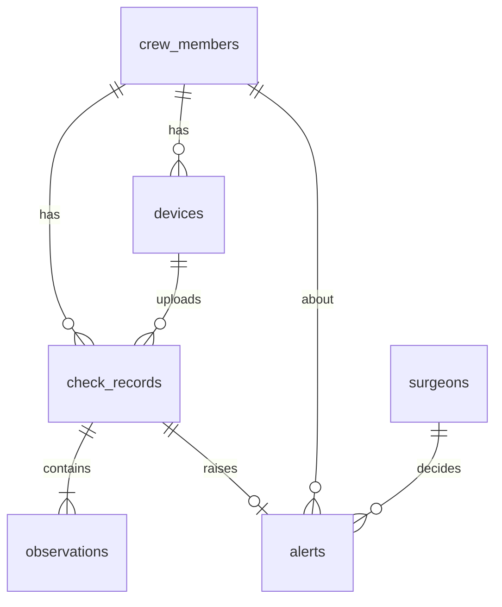

# Base Vital — PostgreSQL schema (backend, feature 004)

Input for `/speckit-plan` of `004-resumen-cirujano` and for the first migration
`backend/migrations/0001_init.sql`. PostgreSQL 16. The database starts empty when `docker compose up` runs;
the backend applies migrations on start (not `docker-entrypoint-initdb.d`), so the schema is versioned.

> **Review status (2026-11-15):** draft. Open mismatches with `libs/contracts`, the constitution and
> the 001 implementation are listed in §6; resolve them in `/speckit-specify` / `/speckit-clarify` of
> 004 before the first migration is written.

Principles applied:
- **No PII**: crew members are pseudonymous (`crew-xxxxxx`); no names, faces, audio or transcripts are stored.
  The voice transcript (`rawText`) is dropped on the device and never reaches the server.
- **Values match `libs/contracts`**: every `CHECK (... IN (...))` list mirrors a Zod enum. A contract test
  compares them, so a value defined twice can't drift.
- **Idempotent sync**: `client_check_id` (generated on the device) is unique; re-sending a check does nothing.
- **Constitution IX** (confirm before recording) is enforced in the database too: a voice value must be confirmed.
- **Strict action rule** (phase 8 review): verdict `green` ⇔ no action; `amber`/`red` ⇔ exactly one action key.

---

## 1. Tables

| Table | One row per | Key fields |
|---|---|---|
| `crew_members` | Astronaut (pseudonymous) | `id` `crew-xxxxxx`, mission start date |
| `devices` | Enrolled crew tablet | crew, label, enrolled / revoked |
| `surgeons` | Flight surgeon account | email, password hash |
| `refresh_tokens` | Issued refresh token (rotating) | subject (device or surgeon), hash, expiry, rotation chain |
| `check_records` | Completed check-in | idempotency key, crew, kind, mission day, verdict, action |
| `observations` | One measured or stated value inside a check | indicator, value, unit, source, level, confirmed, team criterion |
| `alerts` | Check that needs the surgeon | urgency, status, decision, who decided |



---

## 2. SQL — `backend/migrations/0001_init.sql`

```sql
CREATE EXTENSION IF NOT EXISTS pgcrypto;   -- gen_random_uuid()
CREATE EXTENSION IF NOT EXISTS citext;     -- case-insensitive email

-- Crew -----------------------------------------------------------------------
CREATE TABLE crew_members (
  id                  text PRIMARY KEY CHECK (id ~ '^crew-[a-z0-9]{6}$'),
  mission_start_date  date        NOT NULL,
  created_at          timestamptz NOT NULL DEFAULT now()
);

CREATE TABLE devices (
  id           uuid PRIMARY KEY DEFAULT gen_random_uuid(),
  crew_id      text NOT NULL REFERENCES crew_members(id) ON DELETE CASCADE,
  label        text NOT NULL CHECK (length(label) BETWEEN 1 AND 60),
  enrolled_at  timestamptz NOT NULL DEFAULT now(),
  revoked_at   timestamptz
);
CREATE INDEX devices_crew_idx ON devices (crew_id) WHERE revoked_at IS NULL;

-- Surgeons and tokens --------------------------------------------------------
CREATE TABLE surgeons (
  id             uuid PRIMARY KEY DEFAULT gen_random_uuid(),
  email          citext NOT NULL UNIQUE,
  password_hash  text   NOT NULL,                 -- argon2id, never the password
  created_at     timestamptz NOT NULL DEFAULT now()
);

CREATE TABLE refresh_tokens (
  id            uuid PRIMARY KEY DEFAULT gen_random_uuid(),
  subject_type  text NOT NULL CHECK (subject_type IN ('device', 'surgeon')),
  subject_id    uuid NOT NULL,
  token_hash    text NOT NULL UNIQUE,             -- SHA-256 of the token, never the token
  issued_at     timestamptz NOT NULL DEFAULT now(),
  expires_at    timestamptz NOT NULL,
  revoked_at    timestamptz,
  replaced_by   uuid REFERENCES refresh_tokens(id)
);
CREATE INDEX refresh_tokens_subject_idx ON refresh_tokens (subject_type, subject_id) WHERE revoked_at IS NULL;

-- Checks ---------------------------------------------------------------------
CREATE TABLE check_records (
  id               uuid PRIMARY KEY DEFAULT gen_random_uuid(),
  client_check_id  uuid NOT NULL UNIQUE,          -- idempotency key from the device
  crew_id          text NOT NULL REFERENCES crew_members(id) ON DELETE CASCADE,
  device_id        uuid REFERENCES devices(id) ON DELETE SET NULL,
  kind             text NOT NULL CHECK (kind IN ('daily', 'exit')),
  mission_day      integer NOT NULL CHECK (mission_day >= 0),
  verdict          text NOT NULL CHECK (verdict IN ('green', 'amber', 'red')),
  action_key       text,
  completed_at     timestamptz NOT NULL,           -- device clock
  received_at      timestamptz NOT NULL DEFAULT now(),
  CONSTRAINT action_matches_verdict CHECK (
    (verdict = 'green' AND action_key IS NULL) OR
    (verdict IN ('amber', 'red') AND action_key IS NOT NULL)
  )
);
CREATE INDEX check_records_crew_time_idx ON check_records (crew_id, completed_at DESC);

CREATE TABLE observations (
  id               bigint GENERATED ALWAYS AS IDENTITY PRIMARY KEY,
  check_id         uuid NOT NULL REFERENCES check_records(id) ON DELETE CASCADE,
  indicator        text NOT NULL CHECK (indicator IN (
                     'sleep_hours', 'mood', 'resting_heart_rate', 'blood_pressure',
                     'body_temperature', 'oxygen_saturation')),
  value_numeric    numeric(6, 2),
  value_systolic   smallint,
  value_diastolic  smallint,
  unit             text NOT NULL,
  source           text NOT NULL CHECK (source IN ('voice', 'device', 'button')),
  level            text NOT NULL CHECK (level IN ('green', 'amber', 'red', 'in_doubt', 'unknown')),
  confirmed        boolean NOT NULL,
  team_criterion   boolean NOT NULL DEFAULT false, -- result came from a "criterio del equipo" rule
  captured_at      timestamptz NOT NULL,
  CONSTRAINT value_shape CHECK (
    (indicator = 'blood_pressure'
       AND value_systolic IS NOT NULL AND value_diastolic IS NOT NULL AND value_numeric IS NULL)
    OR
    (indicator <> 'blood_pressure'
       AND value_numeric IS NOT NULL AND value_systolic IS NULL AND value_diastolic IS NULL)
    OR
    (level = 'unknown' AND value_numeric IS NULL AND value_systolic IS NULL)   -- "sin dato"
  ),
  CONSTRAINT voice_is_confirmed CHECK (source <> 'voice' OR confirmed),       -- constitution IX
  CONSTRAINT one_value_per_indicator UNIQUE (check_id, indicator)
);
CREATE INDEX observations_check_idx ON observations (check_id);

-- Alerts ---------------------------------------------------------------------
CREATE TABLE alerts (
  id          uuid PRIMARY KEY DEFAULT gen_random_uuid(),
  crew_id     text NOT NULL REFERENCES crew_members(id) ON DELETE CASCADE,
  check_id    uuid NOT NULL UNIQUE REFERENCES check_records(id) ON DELETE CASCADE,
  urgency     text NOT NULL CHECK (urgency IN ('routine', 'soon', 'now')),
  status      text NOT NULL DEFAULT 'open' CHECK (status IN ('open', 'acknowledged', 'resolved')),
  decision    text CHECK (decision IN ('manage_on_base', 'consult_surgeon', 'prepare_return')),
  decided_by  uuid REFERENCES surgeons(id),
  decided_at  timestamptz,
  created_at  timestamptz NOT NULL DEFAULT now(),
  CONSTRAINT decision_needs_surgeon CHECK (
    (decision IS NULL AND decided_by IS NULL AND decided_at IS NULL) OR
    (decision IS NOT NULL AND decided_by IS NOT NULL AND decided_at IS NOT NULL)
  ),
  CONSTRAINT open_has_no_decision CHECK (status <> 'open' OR decision IS NULL)
);
CREATE INDEX alerts_queue_idx ON alerts (status, urgency, created_at) WHERE status <> 'resolved';
```

---

## 3. What is NOT stored (on purpose)

| Not stored | Why |
|---|---|
| Names, photos, voice audio, transcripts | No PII (constitution V). "Ana" exists only on the device |
| Baseline ("tu normal") | Derived from `observations`; computed by `libs/health-rules`, never duplicated |
| Thresholds | Live in `libs/health-rules/thresholds.ts` with their sources |
| Passwords / tokens in clear | Only argon2id hash / SHA-256 hash |

---

## 4. Seed for the demo (`backend/seeds/demo.sql`, dev only)

- `crew_members`: `crew-a1b2c3`, mission start = the date that gives "Día 23 · Luz 9/14" on the demo day
  (same offset as the frontend mission clock).
- One `surgeons` row from `.env` (`SEED_SURGEON_EMAIL`, `SEED_SURGEON_PASSWORD`), hashed on insert.
- 14 days of `check_records` + `observations` with the same fixed-seed variation the frontend uses, so the
  surgeon view shows the same history as the tablet.

---

## 5. docker compose notes

- Service `postgres`: image `postgres:16-alpine`, named volume `pgdata`, port bound to `127.0.0.1:5432` only,
  credentials from `.env` (`POSTGRES_USER`, `POSTGRES_PASSWORD`, `POSTGRES_DB`); `.env.example` has placeholders.
- Service `backend`: waits for `postgres` healthcheck (`pg_isready`), runs migrations, then starts; port
  `127.0.0.1:3000`.
- Service `cloudflared`: Quick Tunnel to `http://backend:3000` — the only door from outside.
- Tests use the in-memory adapter; one integration test runs the migration against a throwaway Postgres
  container to prove the schema and the contracts agree.

---

## 6. Open mismatches (review 2026-11-15, to resolve in 004 specify/clarify)

| # | Here | Today in the repo | Why it matters |
|---|---|---|---|
| M1 | `verdict IN ('green','amber','red')` | Contracts `Verdict` = `ok` / `attention` / `alert` (Level is green/amber/red/in_doubt/unknown) | "Mirrors a Zod enum" is false; the contract test would fail. Use the contract values or rename the enum. |
| M2 | `action_key` NULL for green | Contracts: `actionKey: ''` for `ok` (strict rule, phase 8) | Same rule, different encoding; pick one (NULL in DB with an explicit mapping, or `''`). |
| M3 | `source IN ('voice','device','button')` | Contracts `Source` = `voice` / `device`; a big-button answer is saved as `voice` + confirmed | Either add `button` to the contracts (and 001's reducer) or drop it here. |
| M4 | `client_check_id uuid` | `CheckRecord.id` is an ISO datetime string; there is no UUID on the device | Add a device-generated UUID to the contract, or key on (crew, `id`). |
| M5 | No `simulated` column | Contracts have `simulated` on CheckRecord and Observation; History shows "simulado" | The 14 seeded days must stay marked as simulated in the surgeon view (Principle V). |
| M6 | No symptoms table/column | `CheckRecord.symptoms` drives the verdict (RN5) | The surgeon cannot see why a check is "atención" without symptoms. |
| M7 | `surgeons` with email + password, `refresh_tokens` | Constitution: "No accounts and no per-user cost" | Needs a constitution amendment (MINOR) or a simpler access model (e.g. one shared access code from `.env`). |
| M8 | `kind IN ('daily','exit')` | `exit` belongs to 002, not specified | Principle III (no phantom scope): keep only `daily` until 002 is specified, or note it as reserved. |
| M9 | `observations.level`, `team_criterion` stored | Contracts keep level/teamCriterion on `SensorReading` (per sensor), derived by health-rules | Stored copies of derived data can drift from `thresholds.ts`; decide whether the server stores them or recomputes. |
| M10 | Compose lists postgres, backend, cloudflared | 005 FR-006: frontend too | Add the `frontend` service (bound to 127.0.0.1 only). |
